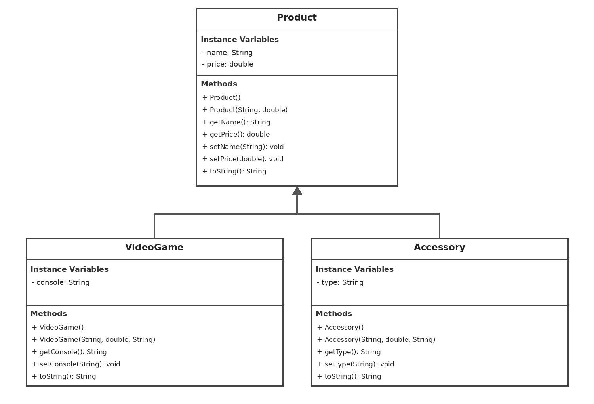

# Unit 2 - Store Management Project

## Introduction

For this project, I created a video game store called GameZone. My store sells video games and gaming accessories. I used Java to make a program that stores information about products, shows their prices, and allows prices to be changed.

## Requirements

For this project, I used object-oriented programming to create a store management system.

- **Class Hierarchy:** I created a superclass called `Product` and two subclasses called `VideoGame` and `Accessory`.
- **Instance Variables:** The `Product` class has `name` and `price`. The `VideoGame` class has `console`, and the `Accessory` class has `type`.
- **Constructors:** Each class has a no-argument constructor and a parameterized constructor. The subclasses use `super` to call the superclass constructor.
- **Accessor and Mutator Methods:** I used getter methods to return information and setter methods to change information about products.
- **toString() Method:** Each class has a `toString()` method that displays information about the objects.

## UML Diagram

## Description

### 1. Description of My Project

For my project, I decided to create a video game store called GameZone because I like video games and thought it would be a fun store to make.

My program uses four Java classes: `Product`, `VideoGame`, `Accessory`, and `StoreRunner`.

The `Product` class is the superclass. It stores the name and price of each product using private instance variables.

The `VideoGame` and `Accessory` classes are subclasses that extend `Product`. This is an example of inheritance because both subclasses inherit methods from the superclass.

The `VideoGame` class has an additional instance variable called `console`, which stores the gaming platform. The `Accessory` class has an additional variable called `type`, which stores the type of accessory.

I used constructors to create objects with different information. I also used the `super` keyword to call constructors from the superclass.

I created accessor methods, also called getters, to return information and mutator methods, also called setters, to change information.

Each class has a `toString()` method that returns information about the object.

In `StoreRunner`, I created different video games and accessories, including Minecraft, NBA 2K, a controller, and a headset. The program prints their information in the console.

I also used setter methods to change the prices of some products and getter methods to display the updated prices.

Finally, I created objects using no-argument constructors to show the default product information.

My program does not ask the user for input. It displays the product information automatically when the program runs.

### 2. How My Project Relates to STEAM

My project relates to STEAM in different ways.

**Science:** I used problem-solving and logical thinking to figure out how my program should work.

**Technology:** I used Java and Code.org to create my store management program. I also used GitHub to store my project files.

**Engineering:** I designed a class hierarchy using a superclass and subclasses. This helped me organize my code and avoid repeating the same methods.

**Art:** I came up with the GameZone store idea and organized how the product information would be displayed in the console.

**Mathematics:** My program uses double variables to store product prices. I also used setter methods to change prices and display the updated amounts.

### 3. Student Learning Outcomes (SLOs)

During this project, I demonstrated my understanding of object-oriented programming.

I learned how to create classes and objects, declare instance variables, and write constructors.

I also practiced using inheritance by creating subclasses that extend a superclass.

I used accessor and mutator methods to get and change information. I also used the `super` keyword and `toString()` methods.

This project helped me understand how different Java classes can work together to create a complete program.
